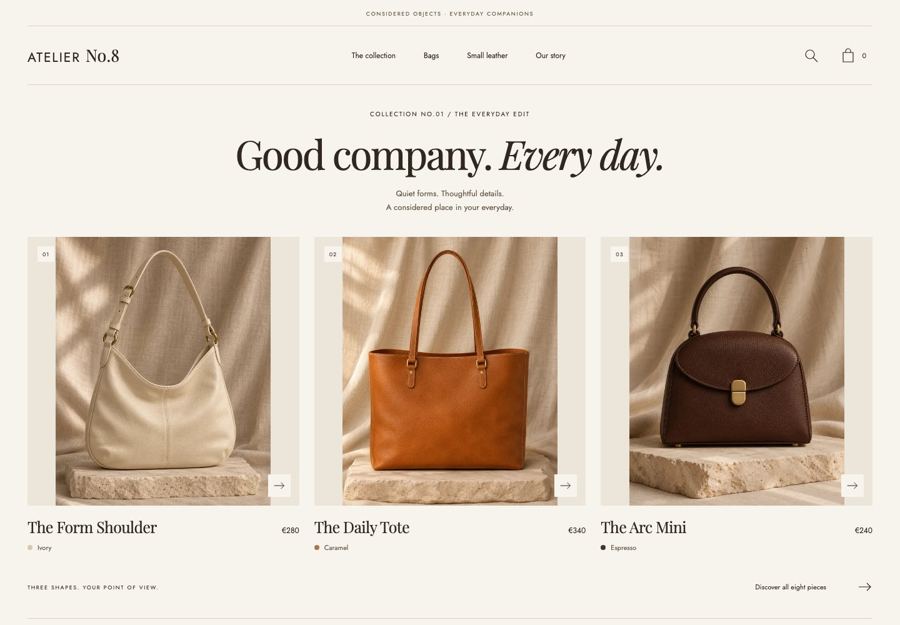

# Atelier No.8

A considered accessories storefront, built with **Nuxt 4, Vue, TypeScript and Pinia**. Created November 2026 as an original fictional-brand portfolio application.



Public demo publication is awaiting the release workflow. The source and all product photography are self-contained.

## Explore the shop

- Eight distinct products with original generated photography, size variants, material notes, integer-cent prices and explicit stock states.
- A centered boutique campaign, searchable collection, category/budget filters and sorting that survive URL reloads.
- Prerendered product routes, thumbnail/material-detail views, a native-dialog photograph viewer, and clear unavailable-size feedback.
- A persistent bag keyed by product **and** size: matching additions merge, different sizes remain separate, and quantities respect stock.
- An accessible local checkout with validation, a review step and a confirmation snapshot that survives later bag resets without changing.
- Locally bundled **Playfair Display + Jost**, responsive product canvases and restrained motion that respects reduced-motion preferences.

This is a demonstration. The brand, inventory, materials and prices are fictional. No product is sold or shipped, no payment is taken, and no email or contact record is transmitted. Photography illustrates the Regular silhouette; size variants are illustrative proportions.

## Run locally

Use Node **22.23.1** and npm **10.9.8**; `.nvmrc` and the committed lockfile pin the baseline.

```sh
npm ci
npm run dev
```

The local app is served at `http://127.0.0.1:4182/atelier-no8-nuxt/`.

```sh
npm run build       # Nuxt static generation, including all eight product routes
npm run preview     # Serve the generated files with the same repository subpath
```

## Try the main flow

1. Filter the collection, then reload: category, search, budget and sorting stay in the URL.
2. Open The Form Shoulder. Add Small twice: the bag shows one line with quantity two. Add Regular: it appears separately.
3. Change quantities, reload, remove an item or clear the bag. The Travel Case demonstrates sold-out stock.
4. Continue to the demo checkout. Use **Use sample details**, confirm the simulation notice, review and complete.

The sample delivery fee is €12 below €250 and complimentary from €250. Prices include illustrative tax; no additional tax is calculated. The bag stores only validated product IDs, size IDs and quantities in `atelier-no8:bag:v1`. Contact fields stay in memory and disappear when the checkout is left or completed. Without browser storage, the shop works for the current session.

## Quality checks

```sh
npm run lint
npm run format:check
npm run typecheck
npm test
npx playwright install chromium webkit
npm run test:e2e
```

Release verification: **12 unit/store tests**, plus **21 browser cases** across desktop Chromium, mobile Chromium and WebKit. Journeys cover URL filters, stock and variant merging, reload recovery, contact validation, immutable confirmation, a complete keyboard-only checkout, native dialog focus restoration, prerendered HTML and deliberate 404 behavior. Layouts are checked at 390, 768 and 1440px. Automated WCAG scans and explicit hydration-mismatch assertions complement the interaction checks; they do not constitute accessibility certification.

On macOS, the WebKit keyboard test uses Safari's native Option-Tab navigation for all interactive controls. Other browser/platform combinations use Tab.

GitHub Actions installs with `npm ci`, runs the same quality checks and browser journeys, then publishes `.output/public` to GitHub Pages only from a passing `main` build. Actions use immutable official commit SHAs and scoped permissions.

## Structure and evidence

- [Architecture and state ownership](docs/ARCHITECTURE.md)
- [Asset provenance and licenses](ASSETS.md)
- [Actual screenshots](docs/screenshots)
- [Measured build payload](docs/payload-report.json)
- [Verification and tooling notes](docs/VERIFICATION.md)

The complete generated artifact is about 2.68 MB, including all images and route HTML. Detailed JavaScript, CSS, WOFF2 and image measurements are kept in the payload report. Gzip values are offline estimates, not a Lighthouse score or live-transfer claim.

Original code is MIT-licensed. Font licenses and generated-artwork provenance remain separate; see [ASSETS.md](ASSETS.md).
